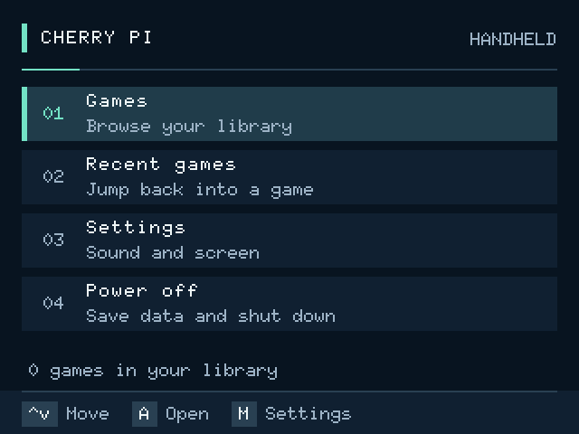

# CherryPi GBA Optimized

Cherry Pi F1C200S 原型的独立软件发布目录，当前组合版本 `2026.10.17-menu-motion`：保留 gpSP 音频指令优化，加入 ROM 文件映射、已验证的第一阶段启动优化，以及静态主题和轻量菜单动画。原始 `smc-live` 发布基线与完整安装资料继续保留。

此目录可单独移动、备份或建立 GitHub 仓库。外部 ARM 交叉编译 SDK 仍需按构建说明准备。

## 当前版本

- **当前安装顺序、程序哈希、启动实测和验证范围**：[当前版本与启动实测](docs/07-当前版本与启动实测.md)。
- **正在使用的 gpSP 源码与安装包**：[ROM 文件映射版](experiments/rom-mmap-20261017/README.md)。
- **已上板验证的启动优化**：[fastboot stage1 r2](experiments/fastboot-stage1-r2-20261017/README.md)。Linux 计时下菜单首帧为 3.56 秒；这不是完整上电时间。
- **特定游戏 ROM 的文字指针修复工具**：[修复说明](experiments/equipo-rom-repair-20261017/README.md)。仓库仅含工具，不含游戏和私人存档。

## 界面改进

- **已上板反馈良好：轻量菜单动画**：[演示、安装和回退](experiments/menu-motion-20261017/README.md)。基于已验证静态主题，120 ms 页面位移、100 ms 高亮渐入；快速输入无需等待，空闲不持续重绘。用户已确认动画效果良好。
- **已上板确认：静态菜单主题**：[预览、安装和回退](experiments/theme-20261017/README.md)。无需 PNG，深蓝背景、薄荷绿选中条、统一字距和按键提示，是动画版的安装前置版本。用户已反馈界面正常。
- **暂缓使用：游戏列表封面预览**：[安装、封面命名和回退](experiments/cover-preview-20261017/README.md)。基于 fastboot r2，已通过本机测试，等待实体板验收；此项尚未计入上面的已验证版本。



## 从这里开始

- **现在这张卡已经能运行，只想保存或重装优化版**：[已有系统升级与回退](docs/02-已有系统升级与回退.md)。
- **换新卡、系统损坏后重装**：[新卡制作与完整安装](docs/01-新卡制作与安装.md)。先烧基础镜像，再安装更新内核和用户程序。
- **启动某个游戏、实体按键、存档和关机**：[运行 GBA 游戏](docs/03-运行GBA游戏.md)。
- **修改源码、测试、提交 GitHub**：[构建与 GitHub](docs/04-构建测试与GitHub.md)。
- **为什么这版变快、测试证据和限制**：[性能优化记录](docs/05-性能优化记录.md)。

## 目录

```text
firmware/                    本地基础镜像 img.gz、镜像校验和元数据
sdcard-files/                将其中的内容复制到 GAMES 根目录
  DISABLE_GBA_AUTOSTART      维护标记，安装期间保留
  roms/                     自行添加 .gba 文件
  cherrypi-kit/
    kernel/                 已用内核 zImage 和 DTB
    packages/               基础运行库、音频、自动启动、设置、主菜单、最终优化包
    SHA256SUMS
components/gpsp/             完整对应源码、测试、符号表、构建脚本、优化程序
components/main-menu/        主菜单源码与测试
components/system-scripts/   监护和设备控制脚本
components/linux-system/     固定版本资料、系统配置、补丁、板级文件和构建脚本
components/audio-tools/      ALSA 对应源码归档、构建配置和包装脚本
tools/                      镜像解压、文件校验、打包和发布检查工具
docs/                       中文安装和使用文档
COPYING、LICENSES/          保留的开源许可
sources.lock.json           上游来源及固定版本
```

## 性能优化基线

下列哈希属于原始 smc-live 基线；当前 ROM 文件映射版的哈希见上面的当前版本文档。

基线优化程序 SHA256：

```text
923fb7fff27a3f0eb2bfc4b3599a62dd0149a478444ee8a521e49a563589f250
```

用户板上从严重卡顿改善为多数运行窗口约 60 模拟帧、偶尔轻微卡顿。不是所有 GBA 游戏的普遍加速补丁，也不保证所有场景或 LCD 实际显示稳定 60 帧。

硬件基线：F1C200S / ARM926EJ-S / 64MiB，当前 480×272 屏、既有 GPIO 接线、板载音频功放；背光调节要求原板 R44 的 0Ω连接已焊好。系统使用 Linux 5.4.196 社区分支与 U-Boot 2022.01，和最初 PCB 工程 README 中的版本不同。

## 发布边界

基础镜像压缩后约 6.6MiB，解压为 321MiB；不是 32GB 整卡备份。它只包含早期基础系统，必须继续安装 kit 中的内核和应用。

基础镜像只保存在本地，`.gitignore` 排除 `.img` 和 `.img.gz`；GitHub 源码目录保留镜像哈希、构建配方和使用说明。克隆仓库的人需要另行取得经校验的基础镜像或自行构建。此目录没有游戏、GBA BIOS、个人存档、账户备份或 SSH 私钥。默认原型系统登录为 `root / cherrypi`，不是面向公网服务的账号配置。

对应源码及第三方许可见 [THIRD_PARTY.md](THIRD_PARTY.md)。GitHub 仓库保存源码、可公开的安装包、文档和校验清单；`local/` 中生成的私人 ROM、存档及安装包不属于公开内容。
